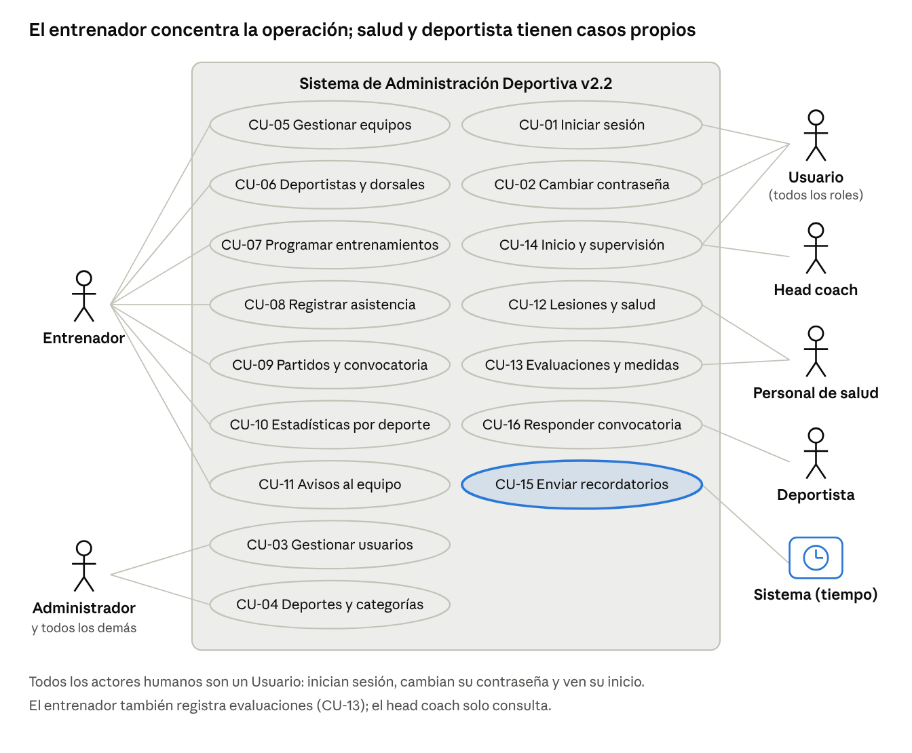

# Historias de usuario y casos de uso — Administración Deportiva

Versión de referencia: **v2.2** · Actualizado: 9 de noviembre de 2026 · Copia editable: documento compartido en Claude ("Historias de usuario y casos de uso — Administración Deportiva").

## Introducción

El sistema tiene **5 actores**, **16 casos de uso** y **20 historias de usuario**, todos tomados de lo que hace la versión **v2.2** (la que está publicada en Railway). Ninguno es una función planeada: cada uno existe en el código y está verificado por al menos un caso de prueba automático.

Este documento completa la documentación de análisis del proyecto. Reemplaza el diagrama de casos de uso de `DOCUMENTACION.html` (7 casos y 2 actores), que había quedado desactualizado.

Cada elemento se enlaza con el resto de la documentación:

| Prefijo | Qué es | Dónde está |
| --- | --- | --- |
| HU-xx | Historia de usuario | Este documento, sección "Historias de usuario" |
| CU-xx | Caso de uso | Este documento, secciones "Diagrama" y "Especificación" |
| RF-xx / RNF-xx | Requisito funcional o no funcional | `docs/calidad/00_requisitos.md` |
| CP-xxx-nnn | Caso de prueba automático | `docs/calidad/casos/catalogo.md` |

Los permisos de cada actor se tomaron de las rutas del backend (`backend/routes/`) y del menú (`frontend/src/config/navegacion.js`). Si el código cambia, este documento debe revisarse junto con el catálogo de requisitos.

## Actores

Hay 5 actores humanos y 1 actor de sistema. Todos entran por el mismo inicio de sesión, y el rol decide qué módulos ven y qué pueden modificar.

| Actor | Rol en el sistema | Qué hace | Módulos que ve | Puede modificar |
| --- | --- | --- | --- | --- |
| Administrador | `administrador` (cuenta inicial `admin1`) | Configura el sistema y supervisa todo | Los 12 módulos (todos excepto Supervisión) | Todo: usuarios, deportes, categorías, equipos, deportistas, agenda, partidos, estadísticas, salud |
| Head coach | `head_coach` | Supervisa a los entrenadores y a sus deportistas | Inicio, Supervisión, Equipos, Deportistas, Entrenamientos, Asistencia, Partidos, Estadísticas, Lesiones, Evaluaciones | Nada: solo consulta |
| Entrenador | `entrenador` | Dirige el plantel de su deporte | Inicio, Equipos, Deportistas, Entrenamientos, Asistencia, Partidos, Estadísticas, Lesiones, Evaluaciones | Equipos, deportistas, dorsales, entrenamientos, asistencia, partidos, convocatorias, estadísticas, avisos y evaluaciones de **sus** deportistas |
| Personal de salud | `personal_salud` | Cuida la salud y la condición física | Inicio, Deportistas, Lesiones, Salud y controles, Evaluaciones, Antropometría | Lesiones, historias clínicas, controles médicos, seguimientos, evaluaciones y medidas |
| Deportista | `jugador` | Consulta su información y responde convocatorias | Inicio, Entrenamientos, Asistencia, Partidos, Mis estadísticas, Lesiones, Salud, Evaluaciones, Antropometría | Solo su respuesta a una convocatoria y su contraseña; todo lo demás lo ve, solo de sí mismo |
| Sistema (tiempo) | Proceso automático del servidor | Envía recordatorios sin que nadie lo pida | — | Crea notificaciones (CU-15) |

Todos los actores humanos pueden además iniciar y cerrar sesión, cambiar su contraseña y leer sus notificaciones de la campanita. Ese comportamiento común se modela con la relación de generalización "Usuario" en el diagrama.

## Diagrama de casos de uso

El entrenador participa en 7 casos de uso del plantel (CU-05 a CU-11). El personal de salud y el deportista tienen los suyos (CU-12, CU-13 y CU-16), y el único actor no humano, el sistema, envía los recordatorios (CU-15). El administrador puede hacer todos los casos de uso; en el diagrama solo se dibujan los exclusivos de su rol, para no llenarlo de líneas.

## Especificación de los casos de uso

Los 16 casos de uso están en la tabla. Los 6 que tienen más reglas o pasan por varios actores se especifican completos debajo: CU-01, CU-03, CU-08, CU-09, CU-10 y CU-12.

| CU | Nombre | Actor principal | Otros actores | Requisitos |
| --- | --- | --- | --- | --- |
| CU-01 | Iniciar sesión | Usuario (todos) | — | RF-01, RF-04 |
| CU-02 | Cambiar contraseña | Usuario (todos) | — | RF-02 |
| CU-03 | Gestionar usuarios | Administrador | — | RF-03 |
| CU-04 | Gestionar deportes y categorías | Administrador | — | RF-06, RF-24 |
| CU-05 | Gestionar equipos | Entrenador | Administrador; head coach consulta | RF-07 |
| CU-06 | Gestionar deportistas y dorsales | Entrenador | Administrador; head coach y salud consultan | RF-08, RF-09 |
| CU-07 | Programar entrenamientos | Entrenador | Administrador; deportista y head coach consultan | RF-10 |
| CU-08 | Registrar asistencia | Entrenador | Administrador; deportista y head coach consultan | RF-11 |
| CU-09 | Gestionar partidos y convocatoria | Entrenador | Administrador; deportista (por CU-16) | RF-12, RF-20 |
| CU-10 | Registrar estadísticas por deporte | Entrenador | Administrador; deportista y head coach consultan | RF-13 |
| CU-11 | Enviar avisos al equipo | Entrenador | Administrador; deportista los recibe | RF-21 |
| CU-12 | Registrar lesiones y salud | Personal de salud | Administrador; deportista consulta lo suyo | RF-14, RF-15 |
| CU-13 | Registrar evaluaciones y antropometría | Personal de salud | Administrador; entrenador registra evaluaciones | RF-16, RF-17 |
| CU-14 | Consultar inicio y supervisión | Usuario (todos) | Head coach (panel de supervisión) | RF-18, RF-19, RF-23 |
| CU-15 | Enviar recordatorios | Sistema (tiempo) | Deportista y entrenador los reciben | RF-22 |
| CU-16 | Responder convocatoria | Deportista | Entrenador recibe la respuesta | RF-20 |

### CU-01 Iniciar sesión

- **Actor:** cualquier usuario registrado.
- **Precondición:** la cuenta existe y está activa.
- **Postcondición:** el usuario tiene una sesión con token renovable y ve solo los módulos de su rol.

**Flujo normal**

1. El usuario abre la aplicación y el sistema muestra el formulario de inicio de sesión.
2. El usuario escribe su usuario corto (por ejemplo `admin1`) o su correo, y su contraseña.
3. El sistema valida las credenciales y crea la sesión.
4. El sistema muestra el Inicio con el saludo, el menú de su rol y el selector de deporte.

**Flujos alternos**

- **3a. Credenciales incorrectas:** el sistema responde "credenciales inválidas" sin decir si el usuario existe, y el usuario vuelve al paso 2.
- **3b. Cinco intentos fallidos seguidos:** el sistema bloquea esa cuenta desde esa dirección durante 15 minutos.
- **3c. Primer ingreso:** el sistema pide cambiar la contraseña inicial antes de seguir (incluye CU-02).
- **3d. Cuenta desactivada:** el sistema no deja entrar hasta que el administrador la reactive (CU-03).

**Pruebas:** CP-AUT-001 a 009, CP-ADM-001, CP-SEG-016, CP-UI-LOG-001 a 003.

### CU-03 Gestionar usuarios

- **Actor:** administrador.
- **Precondición:** sesión de administrador iniciada.
- **Postcondición:** la cuenta queda creada, modificada, desactivada o reactivada, y el cambio se ve en la lista.

**Flujo normal (crear)**

1. El administrador abre Usuarios y elige "Nuevo usuario".
2. Escribe nombre, correo y rol. Si el rol es entrenador, elige su deporte.
3. Si el rol es deportista, llena la ficha deportiva: deporte, equipo, posición y fecha de nacimiento.
4. El sistema crea la cuenta con la contraseña inicial, que se debe cambiar en el primer ingreso. Si es deportista, crea también su ficha y las vincula.

**Flujos alternos**

- **2a. Correo repetido:** el sistema lo rechaza y lo dice.
- **Carga masiva:** el administrador sube un CSV; el sistema crea las filas válidas y lista las que tienen errores.
- **Restablecer contraseña:** la cuenta vuelve a la clave inicial y debe cambiarla al entrar.
- **Desactivar o reactivar:** la cuenta deja de entrar o vuelve a entrar. El administrador no puede desactivar su propia cuenta.

**Pruebas:** CP-MOD-002, CP-PER-001, CP-CSV-003, CP-COR-004, CP-COR-005, CP-OBS-002, CP-OBS-007, CP-SEG-012.

### CU-08 Registrar asistencia

- **Actor:** entrenador (o administrador).
- **Precondición:** existe el entrenamiento y tiene deportistas en su alcance.
- **Postcondición:** cada deportista queda con un único registro, presente o ausente, para esa sesión.

**Flujo normal**

1. El entrenador abre Asistencia y elige la sesión.
2. El sistema muestra la planilla con una ficha por deportista y su dorsal.
3. El entrenador toca cada ficha para marcarla presente o ausente.
4. El sistema guarda cada toque al instante y actualiza el conteo.

**Flujos alternos**

- **3a. Todo el plantel:** con "Todos presentes" o "Todos ausentes" el sistema guarda la planilla completa en una sola operación.
- **3b. Corrección:** tocar de nuevo una ficha cambia el registro existente, sin duplicarlo.
- **3c. Deportista ajeno:** si se intenta registrar un deportista de otro entrenador, el sistema lo rechaza.

**Pruebas:** CP-MOD-007, CP-COR-002, CP-PER-010, CP-INI-004.

### CU-09 Gestionar partidos y convocatoria

- **Actor:** entrenador (o administrador).
- **Precondición:** el entrenador tiene un equipo con deportistas.
- **Postcondición:** el partido queda en el fixture; si la convocatoria se publicó, los convocados tienen un aviso y el registro guarda cada cambio con su autor.

**Flujo normal**

1. El entrenador crea el partido: fecha, hora, rival, tipo (liga, amistoso, torneo o competencia), equipo y lugar.
2. Abre la convocatoria y elige titulares y suplentes de su plantel, con hora y lugar de presentación.
3. Guarda la convocatoria como borrador, que solo ve el cuerpo técnico.
4. La publica, y el sistema avisa a cada convocado en la campanita.
5. Después del partido, registra el resultado en el formato de su deporte: marcador, sets, o tiempo, marca y puesto.

**Flujos alternos**

- **2a. Deportista ajeno:** el sistema no deja convocar a deportistas de otro plantel.
- **4a. Cambio después de publicar:** el sistema avisa solo a los afectados.
- **Respuesta del deportista:** el deportista confirma o avisa que no puede (CU-16), y el entrenador ve la respuesta.

**Pruebas:** CP-MOD-008, CP-COR-001, CP-CNV-001 a 010, CP-UI-CNV-001 a 003.

### CU-10 Registrar estadísticas por deporte

- **Actor:** entrenador (o administrador).
- **Precondición:** el deportista pertenece a su alcance y tiene un deporte asignado.
- **Postcondición:** queda un registro solo con las métricas del deporte del deportista, y la tabla de líderes se actualiza.

**Flujo normal**

1. El entrenador abre Estadísticas y ve las tarjetas de los deportes disponibles.
2. Elige un deporte. El sistema muestra la tabla de líderes con las métricas propias de ese deporte.
3. Elige "Registrar", el deportista y, si aplica, el partido.
4. El sistema muestra solo los campos de ese deporte; por ejemplo, en rugby: tries, conversiones, penales, drops, pases de try, tackles y minutos.
5. El entrenador escribe los valores y guarda.
6. El sistema valida que sean enteros dentro del rango, calcula los totales derivados (puntos del rugby, medallas) y guarda.

**Flujos alternos**

- **5a. Valor inválido** (negativo, texto o sobre el máximo): el sistema no guarda e indica el campo.
- **5b. Métrica de otro deporte:** el sistema la descarta.
- **3a. Deportista de otro entrenador:** el sistema lo rechaza.
- **2a. Deporte nuevo** creado por el administrador: el sistema usa métricas genéricas (puntos o anotaciones, asistencias y minutos).

**Pruebas:** CP-MOD-009, CP-EST-001 a 004.

### CU-12 Registrar lesiones y salud

- **Actor:** personal de salud (o administrador).
- **Precondición:** el deportista existe.
- **Postcondición:** la lesión, el control o el seguimiento queda registrado, y la disponibilidad del deportista se actualiza en el inicio del entrenador.

**Flujo normal**

1. El personal de salud abre Lesiones y registra una lesión: deportista, tipo, descripción y fecha de inicio.
2. En Salud y controles abre la historia clínica del deportista y registra un control médico con su aptitud deportiva.
3. Registra los seguimientos de la lesión y, al recuperarse el deportista, la fecha de fin (alta).
4. El sistema muestra al entrenador al deportista como disponible, con restricciones o no disponible.

**Flujos alternos**

- **1a. Entrenador o deportista intentan registrar una lesión:** el sistema lo rechaza.
- **2a. Historia clínica:** solo la ven el personal de salud y el administrador; el deportista ve solo sus propios controles.

**Pruebas:** CP-MOD-010, CP-MOD-011, CP-PER-002, CP-PER-003, CP-PER-006, CP-PER-007, CP-INI-001, CP-INI-002.

## Historias de usuario

Las 20 historias siguen el formato "Como [rol], quiero [acción], para [beneficio]". Cada una tiene criterios de aceptación verificables y está agrupada por rol. La prioridad (Alta, Media o Baja) es la más alta de los requisitos con los que se enlaza.

### Administrador

| HU | Historia | Criterios de aceptación | Prioridad |
| --- | --- | --- | --- |
| HU-01 | Como administrador, quiero crear cuentas con su rol, para que cada persona entre solo a lo que le corresponde. | 1) El correo no se repite. 2) La cuenta nueva debe cambiar la contraseña en su primer ingreso. 3) Al crear un deportista se crea también su ficha con deporte, equipo, posición y fecha de nacimiento. | Alta |
| HU-02 | Como administrador, quiero desactivar, reactivar y restablecer cuentas, para controlar quién sigue en el sistema sin perder su historial. | 1) Una cuenta desactivada no puede entrar. 2) Al reactivarla vuelve a entrar con sus datos. 3) No puedo desactivar mi propia cuenta. | Alta |
| HU-03 | Como administrador, quiero cargar usuarios desde un CSV, para no crearlos uno por uno al inicio del semestre. | 1) Se crean las filas válidas. 2) Las filas con error se listan con su motivo. | Alta |
| HU-04 | Como administrador, quiero crear deportes y sus categorías, para organizar los equipos de cada disciplina. | 1) Solo el administrador crea y elimina deportes y categorías. 2) Un deporte nuevo usa estadísticas genéricas sin cambiar el código. | Media |

### Entrenador

| HU | Historia | Criterios de aceptación | Prioridad |
| --- | --- | --- | --- |
| HU-05 | Como entrenador, quiero gestionar mis equipos y deportistas con su dorsal, para tener el plantel al día. | 1) Solo veo y modifico a mis deportistas. 2) El dorsal va de 0 a 99 y no se repite en un equipo. 3) El dorsal aparece junto al nombre en todo el sistema. | Alta |
| HU-06 | Como entrenador, quiero programar entrenamientos con hora, lugar y equipo, para que mis deportistas sepan cuándo y dónde entrenar. | 1) Solo puedo elegir equipos de mi deporte. 2) Solo el administrador crea actividades generales. 3) La sesión aparece en la agenda de la semana del equipo. | Alta |
| HU-07 | Como entrenador, quiero tomar asistencia con un toque por deportista, para registrarla en la cancha desde el celular. | 1) Cada toque se guarda al instante. 2) "Todos presentes" guarda el plantel completo. 3) No se duplican registros. | Alta |
| HU-08 | Como entrenador, quiero crear partidos y registrar el resultado en el formato de mi deporte, para llevar el fixture del equipo. | 1) Tipos: liga, amistoso, torneo o competencia. 2) Resultado por marcador, sets o tiempo y puesto según el deporte. 3) La fecha se ve igual a como se guardó. | Media |
| HU-09 | Como entrenador, quiero armar y publicar la convocatoria de un partido, para que los convocados se enteren y confirmen. | 1) El borrador solo lo ve el cuerpo técnico. 2) Al publicar, cada convocado recibe un aviso. 3) Veo quién confirmó y el registro de cambios. | Alta |
| HU-10 | Como entrenador, quiero registrar estadísticas con las métricas de mi deporte, para comparar el rendimiento de mis deportistas. | 1) Solo aparecen las métricas del deporte del deportista. 2) Valores enteros, no negativos y bajo el máximo. 3) Los totales derivados (puntos del rugby, medallas) se calculan solos. | Media |
| HU-11 | Como entrenador, quiero enviar avisos a mi equipo, para comunicar cambios sin usar otros grupos de mensajes. | 1) Solo escribo a mis equipos o a todos mis deportistas. 2) El aviso llega a la campanita de cada uno. | Media |

### Head coach

| HU | Historia | Criterios de aceptación | Prioridad |
| --- | --- | --- | --- |
| HU-12 | Como head coach, quiero ver a mis entrenadores y a sus deportistas en un panel, para supervisar el trabajo de cada deporte. | 1) Veo cada entrenador con su deporte y cuántos deportistas tiene. 2) No puedo modificar datos, solo consultarlos. | Media |

### Personal de salud

| HU | Historia | Criterios de aceptación | Prioridad |
| --- | --- | --- | --- |
| HU-13 | Como personal de salud, quiero registrar lesiones y su seguimiento, para que el entrenador sepa quién está disponible. | 1) Solo salud y el administrador registran lesiones. 2) El inicio del entrenador muestra al deportista como disponible, con restricciones o no disponible. | Alta |
| HU-14 | Como personal de salud, quiero llevar la historia clínica y los controles médicos, para certificar la aptitud deportiva. | 1) La historia clínica solo la ven salud y el administrador. 2) El deportista ve solo sus propios controles. | Alta |
| HU-15 | Como personal de salud, quiero registrar medidas antropométricas y evaluaciones físicas, para seguir la composición corporal y la condición de cada deportista. | 1) El sistema calcula % de grasa, masas y somatotipo. 2) Las evaluaciones dan puntajes normalizados. 3) Nadie fuera del alcance ve esos datos. | Alta |

### Deportista

| HU | Historia | Criterios de aceptación | Prioridad |
| --- | --- | --- | --- |
| HU-16 | Como deportista, quiero ver mi agenda, mi asistencia y mis estadísticas, para saber cómo voy. | 1) Solo veo mis propios datos. 2) Si cambio el número en la dirección para ver a otro, el sistema lo rechaza. | Alta |
| HU-17 | Como deportista, quiero confirmar o avisar que no puedo ir a una convocatoria, para que el entrenador arme el equipo a tiempo. | 1) Puedo responder hasta el día del partido. 2) El entrenador ve mi respuesta. | Alta |
| HU-18 | Como deportista, quiero recibir un recordatorio del entrenamiento de mañana, para no olvidarlo. | 1) Llega una sola vez por actividad. 2) Usa la fecha de Colombia, también después de las 7 p. m. | Media |

### Todos los usuarios

| HU | Historia | Criterios de aceptación | Prioridad |
| --- | --- | --- | --- |
| HU-19 | Como usuario, quiero entrar con mi usuario corto o con mi correo, para no tener que recordar el correo completo. | 1) `admin1` y `admin1@dtdeportivo.com` entran igual. 2) Una contraseña incorrecta muestra un mensaje claro. 3) Cinco intentos fallidos bloquean el ingreso por 15 minutos. | Alta |
| HU-20 | Como usuario, quiero que la aplicación muestre solo mi deporte y los módulos de mi rol, para encontrar rápido lo que necesito. | 1) Si tengo un solo deporte queda fijo. 2) El menú muestra solo mis módulos. 3) Una página de otro rol me devuelve al inicio. | Alta |

## Matriz de trazabilidad

Las 20 historias están cubiertas por al menos un caso de uso, un requisito y un caso de prueba aprobado en el informe v2.2 (`docs/calidad/informes/v2.2.md`). Los 24 requisitos funcionales quedan cubiertos; RF-23 (reconocimientos) entra por CU-14 sin historia propia.

| HU | Caso de uso | Requisitos | Casos de prueba |
| --- | --- | --- | --- |
| HU-01 | CU-03 | RF-03, RF-08 | CP-MOD-002, CP-COR-005, CP-SEG-012 |
| HU-02 | CU-03 | RF-03 | CP-COR-004, CP-MOD-002 |
| HU-03 | CU-03 | RF-03 | CP-CSV-003 |
| HU-04 | CU-04 | RF-06, RF-24 | CP-MOD-003, CP-OBS-003, CP-COR-006, CP-EST-001 |
| HU-05 | CU-05, CU-06 | RF-07, RF-08, RF-09 | CP-MOD-004, CP-MOD-005, CP-PER-004, CP-PER-005, CP-DOR-001 a 008 |
| HU-06 | CU-07 | RF-10 | CP-MOD-006, CP-COR-003, CP-AGE-001 a 006, CP-UI-AGE-001 |
| HU-07 | CU-08 | RF-11 | CP-MOD-007, CP-COR-002, CP-PER-010 |
| HU-08 | CU-09 | RF-12 | CP-MOD-008, CP-COR-001, CP-SEG-009 |
| HU-09 | CU-09 | RF-20 | CP-CNV-001 a 010, CP-UI-CNV-001, CP-UI-CNV-003 |
| HU-10 | CU-10 | RF-13 | CP-MOD-009, CP-EST-001 a 004 |
| HU-11 | CU-11 | RF-21 | CP-COM-001, CP-COM-002, CP-UI-COM-001 |
| HU-12 | CU-14 | RF-19, RF-05 | CP-PER-008, CP-PER-009, CP-INI-007 |
| HU-13 | CU-12 | RF-14 | CP-MOD-010, CP-PER-003, CP-INI-001, CP-INI-002 |
| HU-14 | CU-12 | RF-15 | CP-MOD-011, CP-PER-006, CP-PER-007, CP-OBS-006 |
| HU-15 | CU-13 | RF-16, RF-17 | CP-MOD-012, CP-MOD-013, CP-PER-011, CP-PER-012 |
| HU-16 | CU-14 | RF-05, RF-18 | CP-INI-008, CP-INI-011, CP-PER-002 |
| HU-17 | CU-16 | RF-20 | CP-CNV-004, CP-CNV-006, CP-UI-CNV-002 |
| HU-18 | CU-15 | RF-22, RNF-11 | CP-REC-001 a 003, CP-ZON-001, CP-ZON-002 |
| HU-19 | CU-01, CU-02 | RF-01, RF-02 | CP-AUT-001 a 009, CP-ADM-001, CP-SEG-016, CP-UI-LOG-001 a 003 |
| HU-20 | CU-01, CU-14 | RF-04, RF-06 | CP-OBS-001, CP-UI-NAV-001, CP-UI-NAV-002, CP-UI-OBS-004, CP-UI-REC-001 a 005 |

Para agregar una historia nueva: darle el siguiente número (HU-21), enlazarla con su caso de uso y su requisito, y no darla por terminada hasta que tenga un caso de prueba aprobado en el informe.
